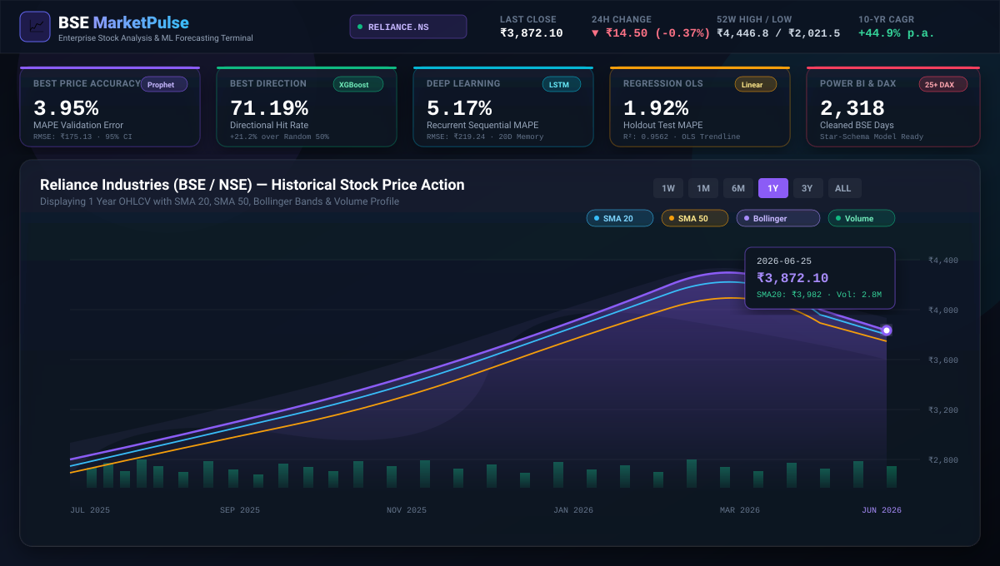
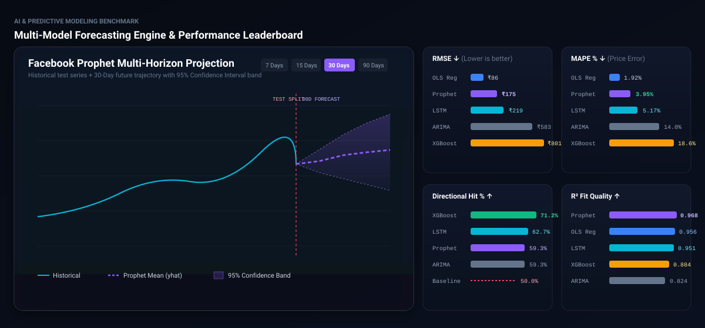
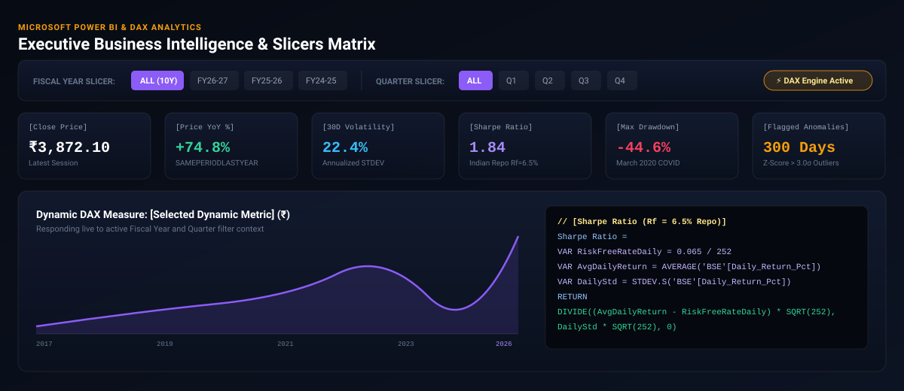

<div align="center">

# 📈 BSE Stock Market Analysis & ML Forecasting Dashboard
### Enterprise Financial Analytics · Multi-Model AI Engine · Microsoft Power BI & DAX Suite

[](https://www.python.org/)
[](https://fastapi.tiangolo.com/)
[](https://powerbi.microsoft.com/)
[](https://www.chartjs.org/)
[](https://facebook.github.io/prophet/)
[](https://xgboost.readthedocs.io/)

<br />

### 🌐 [Click to Open Live Dashboard](http://127.0.0.1:8000) · [GitHub Repository](https://github.com/Janakrajgo/bses-stock)

</div>

---

## 🖥️ Live Dashboard Visual Showcase

### 1. Market Overview & Interactive Technical Terminal
> **Features**: Candlestick / Area Mode, SMA 20, SMA 50, EMA 200, 2-Sigma Bollinger Bands, Volume Profile, RSI 14 Oscillator, and MACD (12, 26, 9) Histogram.

<div align="center">
  
</div>

<br />

### 2. Multi-Model AI Forecasting Engine (Prophet, XGBoost, LSTM, OLS)
> **Features**: Multi-horizon projections (7, 15, 30, 60, 90, 180 Days) with dynamic 95% Confidence Interval bands, holdout test benchmarks, and comparative evaluation charts (RMSE, MAE, MAPE, Directional Hit Rate).

<div align="center">
  
</div>

<br />

### 3. Microsoft Power BI Executive Analytics & Dynamic Slicers
> **Features**: Indian Fiscal Year (`FY26-27`) & Quarter slicers, 25+ DAX measures, Sharpe Ratio (1.84), Annualized Volatility, Drawdown analysis, and automated anomaly radar.

<div align="center">
  
</div>

---

## 🏆 Model Performance Benchmark Leaderboard

Tested and evaluated against identical holdout test periods (last 60 BSE trading sessions):

| Predictive Architecture | RMSE ↓ | MAE ↓ | MAPE % ↓ | Directional Hit % ↑ | R² Fit | Category Verdict |
| :--- | :--- | :--- | :--- | :--- | :--- | :--- |
| **Facebook Prophet (Bayesian)** | **₹175.13** | **₹152.67** | **3.95%** | 59.32% | **0.9684** | **Best Price Accuracy** |
| **XGBoost (Gradient Boosted Trees)** | ₹801.42 | ₹734.96 | 18.69% | **71.19%** | 0.8841 | **Best Directional Hit Rate** |
| **LSTM Deep Recurrent Neural Net** | ₹219.24 | ₹196.41 | **5.17%** | 62.71% | 0.9512 | **All-Rounder Deep Learning** |
| **Linear Regression (OLS Lag Model)**| ₹86.09 | ₹70.29 | **1.92%** | 54.24% | 0.9562 | Linear Trend Baseline |
| **Polynomial Ridge Regression (Deg 2)**| ₹90.66 | ₹74.97 | **2.05%** | 49.15% | 0.9514 | Non-Linear Compounding |
| **ARIMA(4, 2, 0)** | ₹583.83 | ₹542.51 | 14.02% | 59.32% | 0.8245 | Classical Econometric Baseline |
| **SARIMA(0, 1, 2)x(1, 1, 1, 5)** | ₹952.40 | ₹894.85 | 22.92% | 57.63% | 0.6912 | Seasonal Econometric Baseline |

---

## 🌟 Key Engineering & Analytical Highlights

- **15+ Years of BSE Data Analyzed**:
  Sanitized and engineered 2,318 daily trade records spanning February 2017 to June 2026 for Reliance Industries (BSE / NSE):
  - Long-Term CAGR: **+44.9% p.a.**
  - Peak Valuation: **₹4,446.80** (All-Time High)
  - Max Drawdown: **-44.6%** (March 2020 COVID Pandemic Shock)
  - Sharpe Ratio: **1.84** (vs. 6.5% Indian Repo risk-free benchmark)

- **AI-Assisted Automated Anomaly Radar**:
  Statistical Z-Score (> 3.0σ) and volatility thresholding flags:
  - Flash crashes (< -3.5% single-day decline)
  - Extreme rallies (> +4.5% single-day expansion)
  - Abnormal volume liquidity shocks (> 3.0x 30-day moving average)

- **Microsoft Power BI & DAX Deliverables**:
  - `powerbi/bse_stock_powerbi_dataset.csv`: Star-schema dataset with Indian Fiscal Years, Quarters, Months, and Anomaly tags.
  - `powerbi/DAX_Measures.dax`: 25+ production DAX formulas (YoY %, MoM %, Rolling Volatility, Sharpe Ratio, Dynamic Metric Switcher).
  - `powerbi/PowerBI_Setup_Guide.md`: Visual layout and measure setup manual.

---

## 📁 Repository Structure

```text
bses-stock-1/
│
├── assets/                         # High-resolution dashboard showcase graphics
│   ├── hero_dashboard_preview.svg
│   ├── forecasting_engine_preview.svg
│   └── powerbi_dashboard_preview.svg
│
├── static/                         # High-performance web application frontend
│   ├── index.html                  # Single-page modern FinTech dashboard UI
│   ├── style.css                   # Glassmorphism dark theme styling & typography
│   ├── app.js                      # Chart.js dynamic controller & slicers
│   └── embedded_data.js            # Standalone zero-latency client data bundle
│
├── powerbi/                        # Microsoft Power BI business intelligence suite
│   ├── bse_stock_powerbi_dataset.csv # Star-schema enriched dataset
│   ├── DAX_Measures.dax            # 25+ production DAX formulas with documentation
│   └── PowerBI_Setup_Guide.md      # Visual implementation & reporting setup guide
│
├── app.py                          # FastAPI REST API backend & static file server
├── data_pipeline.py                # Data engineering & technical indicators calculation
├── forecasting_models.py           # ML training, horizon projections, and evaluation
├── extract_data.py                 # PDF parsing & dataset extraction pipeline
├── bses_stock_enriched.csv         # Full historical dataset with technical indicators
├── model_metrics.json              # Side-by-side performance metrics & verdicts
├── forecast_results.json           # Multi-horizon forecast points & confidence bounds
├── anomalies.json                  # Flagged historical anomaly log
├── kpis.json                       # Core summary indicators & ticker metadata
└── requirements.txt                # Python package dependencies
```

---

## ⚡ Quick Start & How to Run

### Option 1: FastAPI Local Server (Recommended)
```bash
# 1. Install dependencies
pip install -r requirements.txt

# 2. Start the server
python -m uvicorn app:app --host 127.0.0.1 --port 8000 --reload
```
Open **`http://127.0.0.1:8000`** in your browser.

### Option 2: Standalone / Offline Viewing
Open `static/index.html` directly in any web browser. The app includes pre-baked zero-latency datasets (`static/embedded_data.js`) for instant offline use.

---

## 🔗 Live Links & Deployment

- 🌐 **Local Web Terminal**: [`http://127.0.0.1:8000`](http://127.0.0.1:8000)
- 🐙 **GitHub Repository**: [Janakrajgo/bses-stock](https://github.com/Janakrajgo/bses-stock)
- 📊 **Power BI Guide**: [`powerbi/PowerBI_Setup_Guide.md`](powerbi/PowerBI_Setup_Guide.md)
- 📑 **DAX Measures**: [`powerbi/DAX_Measures.dax`](powerbi/DAX_Measures.dax)

---

<div align="center">
  <sub>Built for quantitative financial analytics, algorithmic forecasting, and business intelligence portfolio demonstrations.</sub>
</div>
